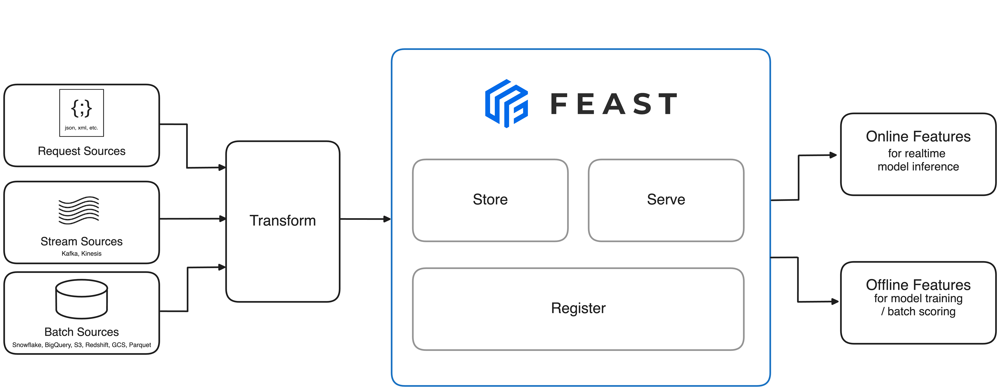
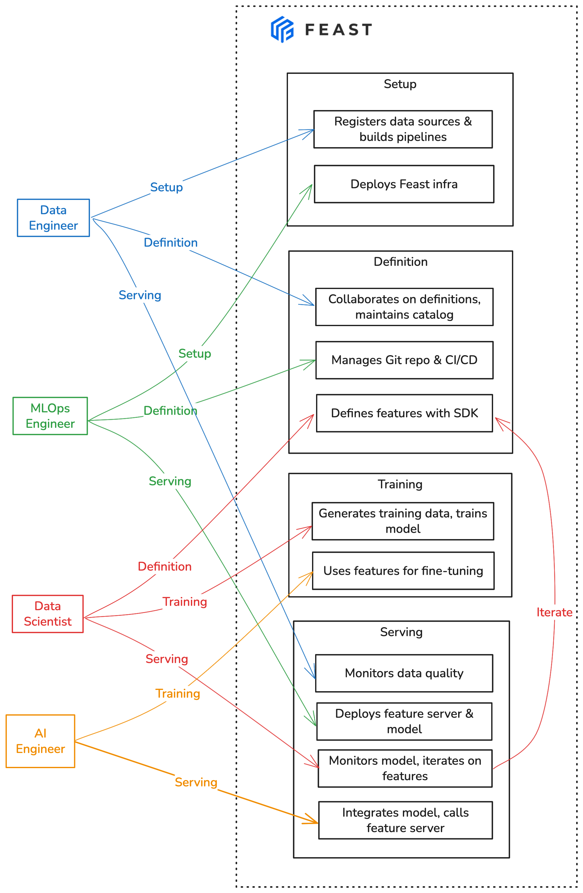

# Introduction

Feast (**Fea**ture **St**ore) is an [open-source](https://github.com/feast-dev/feast) feature store that helps teams operate production ML systems at scale by allowing them to define, manage, validate, and serve machine learning features both in batch and real-time environments. Whether you are training batch or real-time models, Feast reuses your existing data infrastructure to empower both training and inference workflows.

Feast is a configurable operational data system that re-uses existing infrastructure to manage and serve machine learning features to real-time models. For more details, please review our [architecture](getting-started/architecture/overview.md).

## Why Feast?
Feast helps ML platform teams improve productivity, reduce duplication, and ship models to production faster by providing:
- **Consistent features**: Manage an offline store (batch training) and an online store (real-time serving) under one feature server.
- **Avoid Data leakage**: Generate point-in-time correct feature sets to ensure no future data leaks into model training.
- **Decouple ML from data Infra**: Provide a single data access layer that abstracts storage from retrieval, ensuring portability across batch and real-time environments.
- **Serve features at low latency**: Feast is optimized for real-time feature delivery, enabling instant access during inference.
- **Empower collaboration**: Centralize feature definitions so that data scientists, ML engineers, and data engineers can work from a shared catalog.

## Core Components
- **[Offline Store](getting-started/components/offline-store.md)**: Manages historical feature extraction for large-scale batch scoring or model training.
- **[Online Store](getting-started/components/online-store.md)**: Powers low-latency feature serving for real-time production systems.
- **[Feature Server](reference/feature-servers/README.md)**: REST/gRPC interface for online feature retrieval.
- **[Batch Materialization Engine](getting-started/components/batch-materialization-engine.md)**: Loads features from offline to online stores.
- **[Provider](getting-started/components/provider.md)**: Acts as a bridge between Feast and infrastructure.
- **[Authorization Manager](getting-started/components/authorization-manager.md)**: Controls access to features and resources.
- **[OpenTelemetry Integration](getting-started/components/opentelemetry.md)**: Adds observability and tracing.

## User Interfaces
- **[CLI](reference/feast-cli-commands.md)**: Command-line interface for managing feature definitions.
- **[Web UI](reference/alpha-web-ui.md)**: Visual exploration of feature data and metadata.


**Note:** Feast today primarily addresses _timestamped structured data_.



**Note:** Feast uses a push model for online serving. This means that the feature store pushes feature values to the 
online store, which reduces the latency of feature retrieval. This is more efficient than a pull model, where the model 
serving system must make a request to the feature store to retrieve feature values. See 
[this document](getting-started/architecture/push-vs-pull-model.md) for a more detailed discussion.


## Who is Feast for?

Feast helps ML platform/MLOps teams with DevOps experience productionize real-time models. Feast also helps these teams build a feature platform that improves collaboration between data engineers, software engineers, machine learning engineers, and data scientists.

* *For Data Scientists*: Feast is a tool where you can easily define, store, and retrieve your features for both model development and model deployment. By using Feast, you can focus on what you do best: build features that power your AI/ML models and maximize the value of your data.
    
* *For MLOps Engineers*: Feast is a library that allows you to connect your existing infrastructure (e.g., online database, application server, microservice, analytical database, and orchestration tooling) that enables your Data Scientists to ship features for their models to production using a friendly SDK without having to be concerned with software engineering challenges that occur from serving real-time production systems. By using Feast, you can focus on maintaining a resilient system, instead of implementing features for Data Scientists.
    
* *For Data Engineers*: Feast provides a centralized catalog for storing feature definitions, allowing one to maintain a single source of truth for feature data. It provides the abstraction for reading and writing to many different types of offline and online data stores. Using either the provided Python SDK or the feature server service, users can write data to the online and/or offline stores and then read that data out again in either low-latency online scenarios for model inference, or in batch scenarios for model training.

* *For AI Engineers*: Feast provides a platform designed to scale your AI applications by enabling seamless integration of richer data and facilitating fine-tuning. With Feast, you can optimize the performance of your AI models while ensuring a scalable and efficient data pipeline.

## What Feast is not?

### Feast is not

* **An** [**ETL**](https://en.wikipedia.org/wiki/Extract,\_transform,\_load) / [**ELT**](https://en.wikipedia.org/wiki/Extract,\_load,\_transform) **system.** Feast is not a general purpose data pipelining system. Users often leverage tools like [dbt](https://www.getdbt.com) to manage upstream data transformations. Feast does support some [transformations](getting-started/architecture/feature-transformation.md).
* **A data orchestration tool:** Feast does not manage or orchestrate complex workflow DAGs. It relies on upstream data pipelines to produce feature values and integrations with tools like [Airflow](https://airflow.apache.org) to make features consistently available.
* **A data warehouse:** Feast is not a replacement for your data warehouse or the source of truth for all transformed data in your organization. Rather, Feast is a lightweight downstream layer that can serve data from an existing data warehouse (or other data sources) to models in production.
* **A database:** Feast is not a database, but helps manage data stored in other systems (e.g. BigQuery, Snowflake, DynamoDB, Redis) to make features consistently available at training / serving time

### Feast does not _fully_ solve
* **reproducible model training / model backtesting / experiment management**: Feast captures feature and model metadata, but does not version-control datasets / labels or manage train / test splits. Other tools like [DVC](https://dvc.org/), [MLflow](https://www.mlflow.org/), and [Kubeflow](https://www.kubeflow.org/) are better suited for this.
* **batch feature engineering**: Feast supports on-demand and streaming transformations. Feast is also investing in supporting batch transformations. 
* **native streaming feature integration:** Feast enables users to push streaming features, but does not pull from streaming sources or manage streaming pipelines.
* **lineage:** Feast helps tie feature values to model versions, but is not a complete solution for capturing end-to-end lineage from raw data sources to model versions. Feast also has community contributed plugins with [DataHub](https://datahubproject.io/docs/generated/ingestion/sources/feast/) and [Amundsen](https://github.com/amundsen-io/amundsen/blob/4a9d60176767c4d68d1cad5b093320ea22e26a49/databuilder/databuilder/extractor/feast\_extractor.py). 
* **data quality / drift detection**: Feast includes built-in [Feature Quality Monitoring](how-to-guides/feature-monitoring.md) that computes statistical metrics (null rates, distributions, percentiles), detects drift across batch data and serving logs, and provides a monitoring UI dashboard.

## Example use cases

Many companies have used Feast to power real-world ML use cases such as:

* Personalizing online recommendations by leveraging pre-computed historical user or item features.
* Online fraud detection, using features that compare against (pre-computed) historical transaction patterns
* Churn prediction (an offline model), generating feature values for all users at a fixed cadence in batch
* Credit scoring, using pre-computed historical features to compute the probability of default

## Getting Started
- **[Quickstart](getting-started/quickstart.md)**: Fastest way to try Feast with a sample project.
- **[Concepts](getting-started/concepts/)**: Learn key concepts such as entities, feature views, data sources, and transformations.
- **[Architecture](getting-started/architecture/)**: Understand how Feast components interact under the hood.
- **[Tutorials](tutorials/tutorials-overview/)**: Explore end-to-end examples using Feast in real machine learning applications.
- **[How to Guides](how-to-guides/feast-snowflake-gcp-aws/)**: Set up Feast on AWS, GCP, Snowflake, and more.
- **[FAQ](faq.md)**: Frequently asked questions about installation, usage, and limitations.

For contributing guidelines and more advanced usage, see **[Contributing](project/contributing.md)**.
